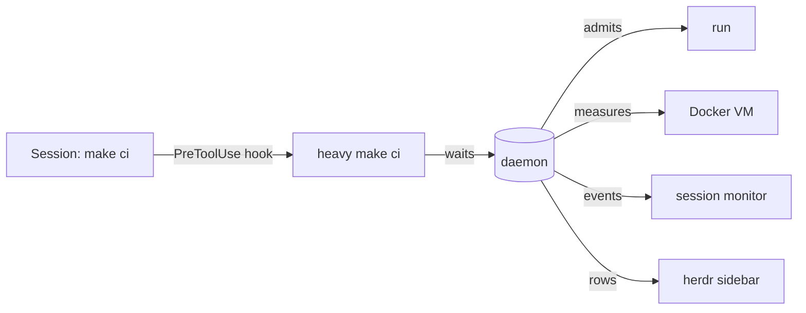

# heavy

[](LICENSE)
[](go.mod)
[](#requirements)
[](#requirements)

A machine-wide queue for heavy commands such as `make ci`, full test runs, type checks and builds. It runs as many of them at once as memory and load allow, and pauses runs before the machine starts to swap.

heavy is one program with a daemon, and it ships as a Claude Code plugin: in Claude Code sessions its hooks put every heavy command into the queue on their own and run it in the background. The queue itself does not need Claude Code; `heavy make ci` in any terminal queues a command the same way, see [Without Claude Code](#without-claude-code).

## Table of Contents

- [Background](#background)
- [Install](#install)
- [Usage](#usage)
- [Configuration](#configuration)
- [How it works](#how-it-works)
- [herdr](#herdr)
- [Limits](#limits)
- [Troubleshooting](#troubleshooting)
- [Contributing](#contributing)
- [License](#license)

## Background

Parallel Claude Code sessions, each in its own git worktree, tend to start their full CI at the same moment. The machine runs out of cores and memory, the Docker VM swaps, and tests hit their timeouts.

heavy puts every heavy command of every session into one queue. A daemon admits a run when the machine has room for it, measures the memory of each run where docker runs it (the Docker VM of a Mac, the machine itself on Linux), and pauses the youngest run under memory pressure. On a Linux machine with several users one limit holds for the runs of all of them. The session that started a run keeps working and hears from heavy when something happens to it.



## Install

### Requirements

- macOS 15 or newer with the Command Line Tools (`xcode-select --install`), or Linux with `/proc` and cgroup v2
- `curl`, or Go 1.27 (<https://go.dev/dl/>, on a Mac `brew install go`): the first session after an install or an update downloads the binaries GitHub built for exactly that version's sources, and checks them against their SHA-256. Without such a build, as in a clone with changes of your own, heavy builds itself with the local Go, which takes a few seconds
- On a Mac: OrbStack, for the measurement inside the Docker VM; without it heavy measures the Mac alone
- On Linux: nothing more. Docker needs no VM there, so heavy reads the machine itself; rootless docker per user works

### Plugin

```text
/plugin marketplace add andreasisaak/heavy
/plugin install heavy@heavy
```

Turn on auto-update for the marketplace under `/plugin` → Marketplaces, so new versions arrive without a manual update.

> [!IMPORTANT]
> After an install or an update, start new sessions instead of resuming old ones. A resumed session keeps the `PATH` of the version it started with.

### Without Claude Code

Build the program from a clone and put it on your `PATH`:

```bash
git clone https://github.com/andreasisaak/heavy.git
cd heavy
go build -o bin/heavy ./cmd/heavy
```

`heavy <command>` then waits for its turn in the queue, runs the command and ends with its exit status; `heavy --status` and `heavy --dashboard` show the queue. The daemon starts on the first call and ends ten minutes after the last run. What only the plugin adds: the hooks that find heavy commands in a session and queue them, the session monitor, and the skills `/heavy:setup` and `/heavy:herdr`. The lists in [Configuration](#configuration) say which commands the hooks queue; a command you start with `heavy` yourself needs no list.

## Usage

In Claude Code:

1. Run `/heavy:setup` in a session inside the project and agree to the proposed list of heavy commands.
2. Work as usual. A listed command such as `make ci`, and every full test run, type check or build, now queues behind `heavy` and runs in the background.
3. Look at the queue:

   ```console
   $ heavy --status
   running    5a15daabd3d7  make ci    ~/sites/shop-feature  3.1 GiB  since 18:08
   waiting 1  40eaa72d5a13  make test  ~/sites/shop          ~2.0 GiB  since 18:09
   failed 2   c580acbda119  make ci    ~/sites/shop          -        ended 18:07
   ```

   A waiting run shows its expected peak memory with `~`, and `~?` when its command has no record yet. A last line `VM: not measured (…)` says that the daemon cannot reach the Docker VM, for example while OrbStack sleeps.

4. Watch the machine live with `heavy --dashboard`: cores, free memory of the VM and the Mac, load, each run with its memory and cores, the free memory of the last 30 minutes, the biggest containers outside the runs and the last results.

| Command | Effect |
|---------|--------|
| `heavy --status [--json]` | the queue as text or JSON |
| `heavy --dashboard` | live view; `↑`/`↓` select, `f` forward, `p` pause or resume, `s` stop, `q` quit |
| `heavy --forward <position>` | moves the run at `waiting <position>` one place ahead |
| `heavy --pause <id>`, `--resume <id>` | pauses or resumes a run with its processes in the VM |
| `heavy --stop <id>` | ends a run and its processes |
| `heavy <command>` | queues a command by hand; the hook does this for you |

The other options (`--daemon`, `--helper`, `--hook`, `--monitor`, `--herdr-refresh`, `--herdr-forward`) belong to heavy itself.

## Configuration

heavy works in a project once a list names the project. It then queues the commands of the lists and every run of the [catalogue](#catalogue).

### `.heavy.json`

Lives in the root of the checkout and travels with the branch, so every worktree and everybody on the project use it:

```json
{"commands": [
  "make test",
  {"command": "make ci", "red": ["^First red in "]},
  {"command": "make test-complete", "unless": ["TEST_WORKERS=12"]},
  {"command": "make e2e", "exclusive": true}
]}
```

| Key | Effect |
|-----|--------|
| `command` | the program and the words that must appear in the call, in order: `make test` matches `make test FILE=x` and `nice make test`, not `make test-file` |
| `unless` | words that free a call from the entry; `TEST_WORKERS=` stands for any non-empty value of that variable, before the program, among the arguments or in the environment |
| `red` | patterns (RE2); the first output line that matches ends the run with exit status 1, so the session learns of a red run at once |
| `exclusive` | the run starts only alone and lets nothing start beside it |
| `restart` | under lasting memory pressure heavy may end the run and start it again as the next run |

List what the catalogue cannot see: make targets, CI scripts, and compose services whose default command does the heavy work. Never list a command that does not end on its own, such as a dev server.

### Personal list

`~/.config/heavy/config.json` applies only to your user on this machine. It is keyed by the main checkout, so it covers every worktree of a repository, and it turns heavy on for a project without a `.heavy.json`:

```json
{
  "projects": {
    "~/sites/shop": {"commands": ["make e2e"]},
    "~/sites/blog": {"enabled": false}
  },
  "load": {"max_parallel": 3, "load_per_core": 0.8}
}
```

`commands` adds to the project's list, `"enabled": false` switches the project's `.heavy.json` and the catalogue off. The optional `load` section sets the thresholds of the queue:

| Key | Default | Meaning |
|-----|---------|---------|
| `max_parallel` | `3`, or the limit of the [machine configuration](#machine-configuration) | runs of this user at once |
| `reserve_bytes` | 2 GiB | memory a new run must leave free in the VM beside its expected peak |
| `vm_pressure_bytes`, `vm_recovered_bytes` | 1.5 GiB, 2.5 GiB | free VM memory below which heavy pauses, and above which it resumes |
| `host_pressure_percent`, `host_recovered_percent` | `10`, `20` | free memory of the host in percent, the same for the host |
| `load_per_core` | `0.8` | a new run starts beside others only below this load per core |
| `swap_bytes_per_2s` | 4 MiB | a new run starts beside others only below this swap-out rate |
| `unpredicted_peak_bytes` | none | the peak memory to expect of a command without any record; with it such a run may start beside others, without it only alone |

On Linux "the VM" in these keys is the machine: its available memory (`MemAvailable`), and at most what the cgroup limits of your user leave (`memory.high` and `memory.max` less the memory in use, which is `memory.current` without the file cache, as systemd sets them with `MemoryHigh` and `MemoryMax` on a user slice).

### Machine configuration

On a machine with several users each user has a queue and a daemon of their own. `/etc/heavy/config.json` sets one limit for the runs of all of them:

```json
{"max_parallel": 8, "slots": "/var/lib/heavy/slots"}
```

| Key | Meaning |
|-----|---------|
| `max_parallel` | runs at once on the whole machine, over all users |
| `slots` | a folder every user can write, with one lock file per run slot |

Create the folder once, for example with `sudo install -d -m 1777 /var/lib/heavy/slots`. Both keys are required. Each daemon locks one slot per active run and the kernel frees the slot of a daemon that dies. While every slot is taken a run waits and prints `heavy: waits for one of the 8 machine slots (/var/lib/heavy/slots)`; a free slot goes to the daemon that asks first, without an order across users. Without the file nothing changes: each user has their own `max_parallel`. A user's own `max_parallel` still lowers the limit for that user.

## How it works

### Admission

A waiting run starts when fewer than `max_parallel` runs are active, none of them in the same git worktree, and nothing exclusive or paused for memory runs. Beside other runs it also needs an expected peak that leaves `reserve_bytes` free in the VM, a Mac with `host_recovered_percent` free, and load and swap below their thresholds. A run with nothing beside it always starts.

Under a [machine configuration](#machine-configuration) the runs of other users count: a run starts unchecked only while no run is active on the whole machine. Beside runs of other users alone it needs the reserve, the load and the swap conditions, but no record of an earlier run, and an `exclusive` run waits until no slot is taken.

The expected peak is the highest of the last five runs of the same command in the same repository. For a new command heavy uses the runs with the same short name, such as `ci` or `vitest`; a command without any record starts only alone. A run that does not fit lets the runs behind it pass that do, until it has waited 15 minutes.

On a machine with much memory that rule keeps a new project waiting run by run, since no command has a record yet. `unpredicted_peak_bytes` in the personal list changes it: heavy then expects that peak of a command without a record and starts it beside others while the free memory holds the estimate and the reserve; load, swap and the free memory of the host count as for any run. Each active run without a record keeps the part of the estimate free that its measured peak has not reached, so of several such runs only as many start as fit. Choose the peak of your biggest command, for example `8589934592` (8 GiB) on a machine with 128 GiB; on a Mac with a small Docker VM leave the key out. `heavy --status` and the dashboard mark such a run: `~8.0 GiB est.` while it waits, `0.5 GiB (est. 8.0 GiB)` while it runs. Its first run gives it a record, and the estimate no longer applies to it.

`HEAVY_CPUS` tells a run how many cores it may use: all of them alone, otherwise what the load leaves. The project decides whether it reads the value, for example for the number of test workers.

### Memory pressure

Pressure means less than `vm_pressure_bytes` free in the VM or less than `host_pressure_percent` free on the host, for 10 seconds. heavy then pauses the youngest run while another keeps running, resumes it after 30 seconds of recovery, and ends and requeues a run with `restart` when pressure lasts. A pause freezes the run's process group, its tagged processes in the VM and the containers of its worktree it started. On Linux the tagged processes are those in containers that the daemon's user may signal; a process under another user id, as rootless docker runs the non-root users of a container, is left to the pause of its container.

### Session monitor

Every interactive session runs the plugin monitor `heavy`, which tells the session what the background task of a run cannot:

```text
heavy: your run ci (5a15daabd3d7) started at 18:02:11 with 9 cores
heavy: your run ci (5a15daabd3d7) was paused at 18:14:02: VM 1.2 GiB free, host 8 % free
heavy: your run ci (5a15daabd3d7) is red since 18:20:40 and is being stopped: First red in PHPUnit at 18:20:40: CartTest
heavy: your run ci (5a15daabd3d7) ended at 18:20:41 with exit status 143 (red) after 18m30s
heavy: memory is low (VM 1.4 GiB free); shop-app-1 of this repository uses 1.5 GiB. If you do not need it now: docker compose --project-directory /Users/me/sites/shop stop app
heavy: the queue daemon is unreachable since 00:03:11 (…); your runs keep running and heavy keeps trying
```

On Linux the lines say `machine` where a Mac says `VM`.

The end of a run reaches the session as the end of its background task.

### Shims

The SessionStart hook puts `shims/` in front of `PATH` for every Bash call of the session. The shims stand in for `docker`, `make`, `gmake`, `pnpm`, `pnpx`, `npm`, `npx`, `yarn`, `bun`, `bunx`, `uv`, `uvx` and `composer`, only in Claude Code sessions. A heavy call that the hook missed, because a variable, a script or a make target hid it, waits in the queue there. A light call goes straight to the real program, in about 13 ms for `make --version`.

Inside a run, `docker exec`, `docker run` and `docker compose exec|run` get `-e HEAVY_RUN=<id> -e HEAVY_CPUS=<n>`, so heavy finds, measures and pauses the processes in the containers.

### Catalogue

In a project with heavy on, these runs queue without an entry, also behind `docker compose exec`, `pnpm`, `npx`, `uv run`, `php` and other launchers.

<details>
<summary>Runners, checks and builds of the catalogue</summary>

- Test runners: `vitest`, `jest`, `playwright test`, `phpunit`, `paratest`, `pest`, `pytest`, `php artisan test`, `mocha`, `cypress run`, `test-storybook`, `bun test`, `deno test`, `cargo test`, `go test`.
- Checks of the whole project: `vue-tsc`, `tsc`, `phpstan analyse`, `psalm`, `deptrac`, `mypy`, `pyright`, `cargo clippy`, `cargo check`, `go vet`, and `eslint` and `stylelint` on a directory, a glob or no target.
- Builds: `vite build`, `nuxt build`, `nuxi typecheck`, `next build`, `astro build`, `storybook build`, `cargo build`, `go build`.
- Package scripts named `test`, `build`, `typecheck`, `check`, `ci`, `e2e`, `coverage`, `lint`, `analyse`, `phpstan` or `psalm`, also with a suffix such as `test:e2e`; not with `watch`, `serve`, `server`, `ui`, `open`, `start` or `preview`.

| Queued | Free |
|--------|------|
| `pnpm exec vitest run --project unit` | `vitest run tests/cart.spec.ts`: one to three source files |
| `pytest tests/`, `pytest -k cart` | `pytest tests/test_cart.py::test_total` |
| `php artisan test --filter=CartTest` | `php artisan test tests/Feature/CartTest.php` |
| `eslint .`, `eslint 'src/**/*.ts'` | `eslint src/cart.ts src/total.ts`: files of any number |
| | `vitest watch`, `--watch`, `--ui`: runs that never end |

</details>

### Agents

The hooks steer the sessions so that they code while their runs wait:

- Subagents start no heavy run; they name the command, and the main agent runs it once for all changes.
- `| tail`, `| head` and `| grep` at the end of a heavy run go, so the full output stays readable in the task output.
- `heavy --status` while the session's own run waits or runs is denied: the session hears when its run ends.
- The first `TaskStop` of a heavy run is denied with what stopping costs; the same stop again within ten minutes passes.

## herdr

`/heavy:herdr` shows each heavy run of an agent in a row of its own in the [herdr](https://herdr.dev) sidebar (herdr 0.9.1 or newer), in every running herdr session:

| Row | Meaning |
|-----|---------|
| `▶ 6m · ci` | runs for 6 minutes (yellow) |
| `⏸ 4m · test` | paused (orange) |
| `⧗ 3m · #1 · ci` | waits, next in line (grey) |
| `✓ 13m · ci`, `✗ 13m · ci` | ended green or red, shown for 30 seconds |

The skill links the herdr plugin `local.heavy-queue`, adds the rows to `~/.config/herdr/config.toml` after one yes/no question, and binds `prefix+f` to move a run ahead and `prefix+d` to open the dashboard.

## Limits

- macOS and Linux only; on a Mac with OrbStack for the VM side.
- One run per git worktree, and three per user unless `max_parallel` or the machine configuration says otherwise.
- Across the users of a machine there is one limit but no queue order, and heavy sees an `exclusive` run of another user only as a taken slot.
- Pressure stall information (`/proc/pressure`) is read on Linux but admits and pauses nothing yet.
- A heavy call that only a shim catches runs in the foreground of its Bash call and ends with that call's timeout.
- Programs called by absolute path, such as `/usr/local/bin/docker`, bypass the shims; the hook still sees them by name.
- A heavy command the hook cannot place inside a call, such as in `$( … )` or in the string of `ssh host '…'`, runs with the whole call through `heavy "$SHELL" -c '…'`, without your shell profile. With other work before it in the same call, the hook denies the call and says how to split it.

## Troubleshooting

### `heavy: found no build of these sources to download and no go on PATH; …`

The first session after an install or an update downloads heavy from the release `build-<stamp>` of this repository, which GitHub builds a few minutes after each change. Start a new session a little later, or install Go 1.27, with which heavy builds itself.

### Commands still go through the old version after an update

A resumed session keeps the `PATH` of the version it started with. Start a new session instead of `claude --resume`.

### The herdr sidebar shows no heavy rows

Rows appear only while a run waits or runs, and for 30 seconds after its end. Check `heavy --status`; if a run is listed, run `/heavy:herdr` once more.

### `heavy: the slot folder … is missing; create it with mode 1777`

The machine configuration names a folder that does not exist. The run started without a slot, so the limit of the machine does not hold until the folder is there: `sudo install -d -m 1777 <folder>`.

### A run waits although the machine looks idle

`heavy --dashboard` shows why: a run beside others needs load below `load_per_core` and enough free VM memory for its expected peak. One `make ci` can keep the load above that threshold on its own.

A run that shows `~?` in `heavy --status` has no record of an earlier run and starts only when no other run of yours is active. On a new machine that holds for almost every command, so the queue runs one by one although load and memory are low. Set `unpredicted_peak_bytes` in the `load` section of `~/.config/heavy/config.json`, see [Admission](#admission); the daemon reads the file again within two seconds.

## Contributing

```bash
go test ./...
```

[AGENTS.md](AGENTS.md) lists the checks and conventions of this repository, and [CHANGELOG.md](CHANGELOG.md) the changes of each version.

## License

[MIT](LICENSE) © 2026 Andreas Isaak
